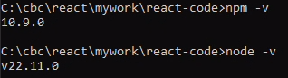
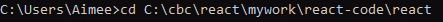
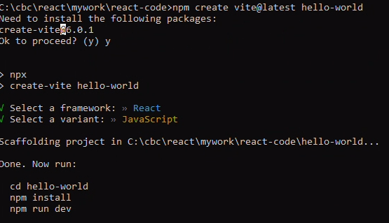
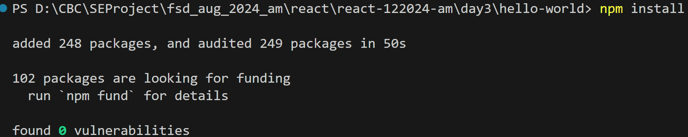
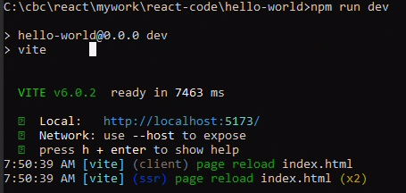

# FSWD-MERN-Nov-2026-AM

## ES6 

[React ES6](https://www.w3schools.com/react/react_es6.asp)


## Install node 

[Download Node](https://nodejs.org/en/download)

- Verfiy if the node and NPM is installed 

```
node -v 
```


```
npm -v
npm --version
```
- or 
```
npm view npm version
```
- if NPM not found, install npm
- 


```
npm install -g npm@latest
```


## Create the hello world react app 

```
npm create vite@latest hello-world
```

## Install the VS Code extension for React snippets

- ES7+ React/Redux/React-Native snippets


### Useful Resources
[React Learn](https://react.dev/learn)

[React W3School](https://www.w3schools.com/react/default.asp)

[Node](https://nodejs.org/en)

### Videos
[REACT](https://m.youtube.com/watch?v=8pDqJVdNa44&t=1522s&pp=ygURY3JlYXRvcnMgb2YgcmVhY3Q%3D#)
[Node](https://www.youtube.com/watch?v=LB8KwiiUGy0&t=3s&ab_channel=Honeypot)


### To Check the node and NPM version 



### To Create a React App using Vite



>cd your-path



> npm create vite@latest app-name

> cd app-name

> 

> npm install

> 

> npm run dev 
>
> https://www.npmjs.com/package/react-icons
> npm i react-icons
>
> https://www.npmjs.com/package/json-server
> npm i json-server
> 
>--create a folder data and create list.json file in that folder
> npx json-server -p 3500 -w .\data\list.json
>